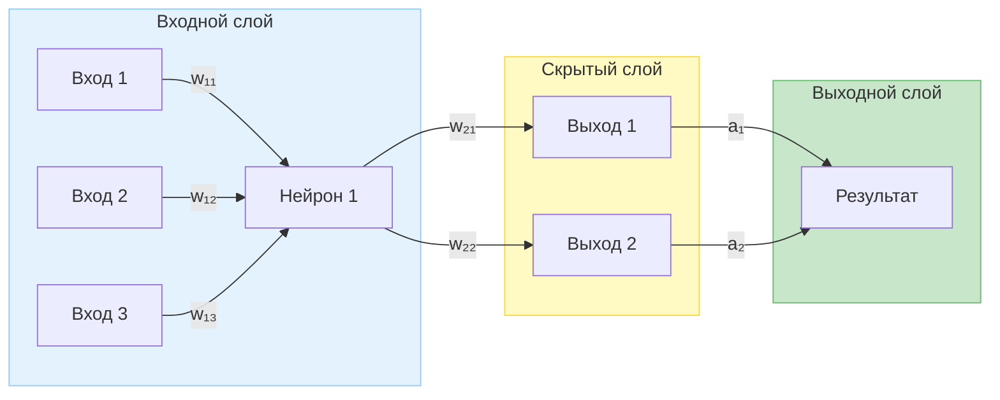

# Механизм работы нейронных сетей: от биологического вдохновения до современных больших языковых моделей

> Познавательный материал · Обновлено: 2026-11-12 15:18

## Содержание

- [Введение  ](#введение)
- [1. Исторический обзор  ](#1-исторический-обзор)
- [2. Биологический прототип и математический аналог  ](#2-биологический-прототип-и-математический-аналог)
- [3. Архитектура и типы нейронных сетей  ](#3-архитектура-и-типы-нейронных-сетей)
- [4. Обучение нейронных сетей  ](#4-обучение-нейронных-сетей)
- [5. Примеры современных систем  ](#5-примеры-современных-систем)
- [6. Наглядная схема типичной полносвязной сети  ](#6-наглядная-схема-типичной-полносвязной-сети)
- [7. Практическое значение  ](#7-практическое-значение)
- [8. Интересные факты  ](#8-интересные-факты)
- [9. Заключение  ](#9-заключение)

---

## Введение  
Нейронные сети (нейронные сети искусственного интеллекта) — это математические модели, имитирующие работу биологических нейронов. За несколько десятилетий они превратились из теоретических конструкций в основу современных систем генерации текста, изображений, речи и управления. В статье рассматриваются исторические вехи, базовые принципы функционирования, архитектурные варианты и практические применения.

## 1. Исторический обзор  

| Год | Событие | Значение |
|-----|----------|----------|
| **1943** | У. Маккалок и У. Питтс опубликовали первую формальную модель нейронов (логический нейрон) | Заложил теоретический фундамент искусственных нейронных сетей |
| **1958‑1960‑е** | Появление перцептрона Фрэнка Розенблатта | Первый обучаемый многослойный классификатор |
| **1986** | Выведение алгоритма обратного распространения ошибки (backpropagation) | Сделал обучение многослойных сетей практичным |
| **2012** | Победа сети AlexNet в конкурсе ImageNet | Демонстрация потенциала глубокого обучения в компьютерном зрении |
| **2017** | Запуск виртуального ассистента «Алиса AI» от Яндекса (многослойная нейросеть) | Применение нейросетей в диалоговых системах на русском языке |
| **2022** | Публичный релиз ChatGPT (модель GPT‑3.5) | Широкое внедрение генеративных трансформеров в пользовательские сервисы |
| **2023** | Появление YandexGPT / Alice AI и GigaChat от Сбера | Конкурентные большие языковые модели в российском ИТ‑пространстве |
| **2024‑2026** | Дальнейшее развитие трансформеров (GPT‑4, GPT‑5, GPT‑6) и их интеграция в облачные сервисы | Увеличение масштабов и возможностей генеративных моделей |

## 2. Биологический прототип и математический аналог  

### 2.1 Биологический нейрон  
- Дендриты получают сигналы от других нейронов.  
- Сома (тело клетки) суммирует входные потенциалы.  
- При превышении порогового значения генерируется акционный потенциал, который передаётся по аксону к синапсам.

### 2.2 Искусственный нейрон  
- **Входы** — числовые признаки \(x_1, x_2, \dots, x_n\).  
- **Веса** \(w_1, w_2, \dots, w_n\) определяют важность каждого входа.  
- **Суммирующая функция** \(z = \sum_{i=1}^{n} w_i x_i + b\) (смещение \(b\)).  
- **Активационная функция** \(a = \phi(z)\) (например, ReLU, сигмоида, tanh) вводит нелинейность, позволяя сети решать сложные задачи.  

## 3. Архитектура и типы нейронных сетей  

### 3.1 Классическая многослойная перцептронная сеть (MLP)  
Состоит из входного слоя, одного или нескольких скрытых слоёв и выходного слоя. Обучается методом обратного распространения ошибки.

### 3.2 Сверточные нейронные сети (CNN)  
Используют сверточные ядра для извлечения локальных признаков из изображений и сигналов. Плюс слои подвыборки (pooling) для снижения размерности.

### 3.3 Рекуррентные нейронные сети (RNN) и их варианты (LSTM, GRU)  
Обрабатывают последовательные данные, передавая скрытое состояние от шага к шагу, что позволяет учитывать контекст.

### 3.4 Трансформеры  
Основаны на механизме «self‑attention», позволяющем одновременно учитывать все элементы последовательности. Являются базой современных больших языковых моделей (LLM) — GPT, BERT, YandexGPT, GigaChat.

### 3.5 Сравнительная таблица  

| Тип сети | Основная задача | Ключевой механизм | Пример применения |
|----------|----------------|-------------------|-------------------|
| Perceptron | Линейная классификация | Пороговая активация | Простейшие бинарные задачи |
| MLP | Общая классификация/регрессия | Полносвязные слои + backprop | Распознавание рукописных цифр |
| CNN | Обработка изображений | Свертка + pooling | Распознавание объектов, медицинская диагностика |
| RNN / LSTM | Последовательные данные | Скрытое состояние, память | Перевод текста, распознавание речи |
| Transformer | Длинные последовательности | Self‑attention | Большие языковые модели, генерация кода |

## 4. Обучение нейронных сетей  

1. **Подготовка данных** – нормализация, аугментация, разбиение на обучающую/валидационную/тестовую выборки.  
2. **Определение функции потерь** – измеряет расхождение предсказания сети и истинного значения (MSE, кросс‑энтропия и др.).  
3. **Оптимизация** – градиентный спуск (SGD, Adam, RMSprop) обновляет веса в направлении уменьшения потерь.  
4. **Обратное распространение** – вычисление градиентов по цепочке производных от выхода к входу.  
5. **Эпохи и батчи** – итеративное прохождение по всему набору данных; размер батча влияет на стабильность и скорость обучения.  

### 4.1 Переобучение и регуляризация  
- **Переобучение** — сеть запоминает шум обучающей выборки, теряя обобщающую способность.  
- **Регуляризаторы**: L1/L2‑штраф, dropout, ранняя остановка, батч‑нормализация.  

## 5. Примеры современных систем  

| Система | Архитектура | Основные возможности | Дата выпуска |
|---------|-------------|----------------------|--------------|
| **Алиса AI** (Яндекс) | Многослойный трансформер + специализированные диалоговые модули | Голосовой помощник, генерация текста, работа с файлами | 2017 (первый релиз), последняя версия 2026 |
| **ChatGPT** (OpenAI) | GPT‑4/5/6 (трансформер) | Диалог, генерация кода, создание изображений (в новых версиях) | 2022 (публичный запуск) |
| **GigaChat** (Сбер) | Трансформер, адаптированный под русский язык | Текстовое и голосовое общение, генерация кода, поддержка нескольких платформ | 2023 (публичный доступ) |
| **YandexGPT / Alice AI** | Большой трансформер, обученный на русскоязычных корпусах | Поисковый ассистент, генерация статей, контекстный диалог | 2023‑2025 |

## 6. Наглядная схема типичной полносвязной сети  

Схема иллюстрирует процесс: входные признаки умножаются на веса, суммируются, проходят через активацию, а затем передаются дальше.

## 7. Практическое значение  

- **Автоматизация**: распознавание речи, обработка запросов в поисковых системах, фильтрация спама.  
- **Медицина**: диагностика по изображениям, прогнозирование заболеваний.  
- **Творчество**: генерация текста, музыки, изображений, кода.  
- **Бизнес‑аналитика**: прогноз спроса, оценка кредитного риска, персонализация рекомендаций.  

## 8. Интересные факты  

- Первая нейронная сеть, построенная на реальном компьютере (Perceptron), могла обучаться в реальном времени, но была ограничена линейными задачами.  
- Переход от сверточных сетей к трансформерам в 2017‑м году (модель *Attention is All You Need*) позволил избавиться от необходимости фиксировать порядок обработки данных, что ускорило обучение больших языковых моделей.  
- Современные LLM, такие как GPT‑6 (2026), содержат сотни миллиардов параметров, однако их эффективность сильно зависит от качества и разнообразия обучающих данных.  

## 9. Заключение  
Нейронные сети прошли путь от простых математических моделей, вдохновлённых биологическими нейронами, до масштабных трансформеров, способных вести осмысленные диалоги, писать код и создавать искусство. Ключевыми элементами их работы являются взвешенные суммы входов, нелинейные активации и обучение через градиентный спуск. Постоянное развитие архитектур, методов регуляризации и вычислительных платформ открывает новые горизонты применения ИИ в самых разных отраслях, делая нейросети фундаментальной технологией современного мира.

---

## Источники и дополнительное чтение

1. Алиса AI
https://ru.wikipedia.org/wiki/%D0%90%D0%BB%D0%B8%D1%81%D0%B0_AI
2025 года Нейросеть Алиса, до 2024 года Алиса) — нейросеть , созданная компанией Яндекс. Работает в двух форматах: как нейросеть в чат-боте и как виртуальный
2. Нейронная сеть
https://ru.wikipedia.org/wiki/%D0%9D%D0%B5%D0%B9%D1%80%D0%BE%D0%BD%D0%BD%D0%B0%D1%8F_%D1%81%D0%B5%D1%82%D1%8C
Нейро́нная сеть (также иску́сственная нейро́нная сеть, ИНС, или просто нейросе́ть ) — математическая модель, а также её программное или аппаратное воплощение
3. Alice AI
https://ru.wikipedia.org/wiki/Alice_AI
высказывания политика. Нейросеть YandexGPT не готова разговаривать об Украине, о вторжении России на Украину, статусе Крыма, ДНР и ЛНР. Нейросеть также не готова
4. ГигаЧат
https://ru.wikipedia.org/wiki/%D0%93%D0%B8%D0%B3%D0%B0%D0%A7%D0%B0%D1%82
обращения: 19 декабря 2024. Андрей Бритенков. Нейросеть Сбера научилась писать музыку: как это работает . Hi-tech Mail.ru (13 декабря 2024). Дата обращения:
5. ChatGPT
https://ru.wikipedia.org/wiki/ChatGPT
Абрамов, Андрей (1 февраля 2023). Нейросеть за один вечер написала диплом за российского студента. Преподаватели в шоке – как теперь проверять знания?. msk
6. Яндекс
https://ru.wikipedia.org/wiki/%D0%AF%D0%BD%D0%B4%D0%B5%D0%BA%D1%81
изображения по описанию. 17 мая 2023 года «Яндекс» запустил свою нейросеть YandexGPT (аналог нейросети компании OpenAI — ChatGPT) с сервисами YandexGPT, YandexART
7. Макс (мессенджер)
https://ru.wikipedia.org/wiki/%D0%9C%D0%B0%D0%BA%D1%81_%28%D0%BC%D0%B5%D1%81%D1%81%D0%B5%D0%BD%D0%B4%D0%B6%D0%B5%D1%80%29
провайдеров или Роскомнадзора. Помимо этого, в исходном коде была найдена нейросеть для нешифрованной записи и анализа голосовых вызовов; несмотря на ее удаление
8. OpenAI
https://ru.wikipedia.org/wiki/OpenAI
Дата обращения: 12 сентября 2024. OpenAI представила модель o3: нейросеть мыслит почти как человек. Hi-tech Mail.ru. 24 декабря 2024. Архивировано 29 января

---

Материал подготовлен с использованием указанных источников. Изображения предоставлены Wikimedia Commons; условия использования указаны возле иллюстраций.
